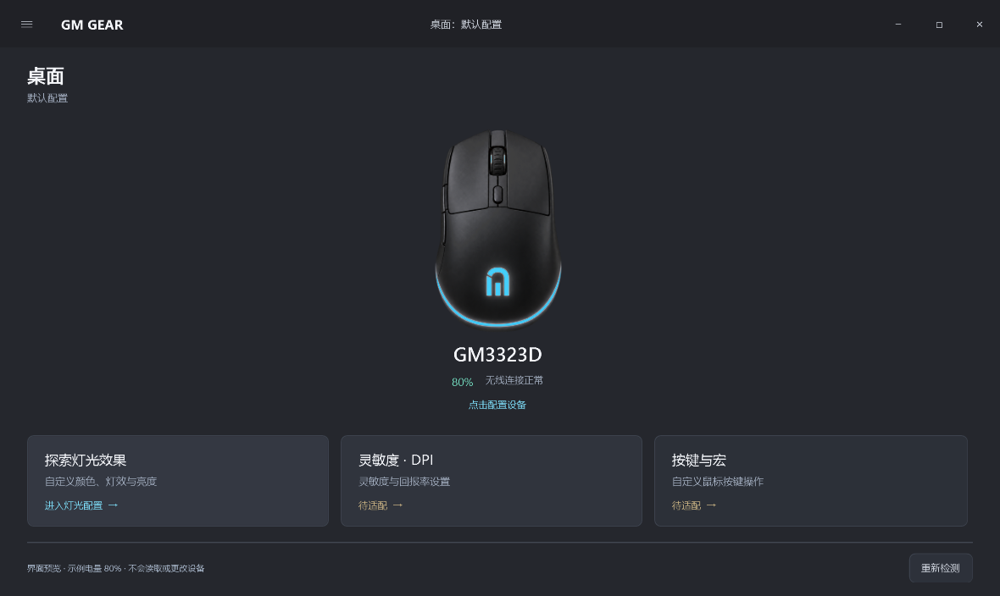
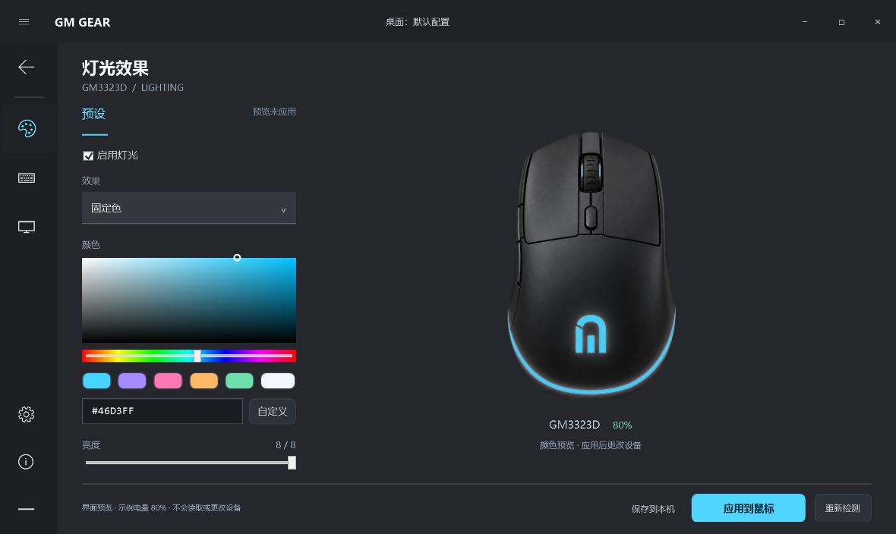

# GM GEAR · GM3323D 控制中心

面向 **GM3323D** 的独立 Windows 鼠标控制软件。按经典 G HUB 的交互布局制作：居中设备主页、顶部桌面配置栏、左侧功能图标栏、灯光面板与设备颜色预览。使用独立名称与参考实物制作的鼠标图，不与罗技或戴尔关联。

基于 [Evan816Z/GM3323D-MouseLight](https://github.com/Evan816Z/GM3323D-MouseLight) 二次开发，复用并移植其原生 HID 枚举、132 字节灯光配置及电量监听方案，保留 MIT 许可证和上游 C++ 源码。原来的电量查看器不需要卸载，也不会被新软件替换。

## 当前功能

- **设备主页**：GM3323D 连接状态与实测电量，点击鼠标进入配置。
- **灯光面板**：8 种已知灯效、开关、HSV 取色、HEX 输入、颜色预设、1–8 档亮度；白色灯带和掌心标志随所选颜色与亮度预览，保留鼠标外壳材质。
- **明确应用**：只有点击“应用到鼠标”才发送设置。保存到本机只保存草稿；启动、重连和载入草稿均不会自动写设备。
- **电量托盘**：后台连续监听，只读 Input Report；断开或长时间无回复清除旧值。
- **独立设置**：可选开机自启，默认关闭；关闭窗口可收起托盘。注册表使用 `HKCU\Software\GM3323DGearHub`，与原工具独立。
- **未适配功能**：DPI、回报率、按键分配和宏当前只显示状态说明，不提供假控件或写入。

## 运行

下载 GM GEAR 单文件程序 `GM-GearHub.exe`，放到固定位置后双击即可。需要 Windows 10/11 x64 与系统 .NET Framework 4.8；不需要 Python、Node.js、管理员权限或安装内核驱动。

1. 插入 GM3323D 无线接收器，移动鼠标唤醒。
2. 双击 `GM-GearHub.exe`。
3. 在主页点击鼠标，打开灯光配置。
4. 先预览颜色和亮度，准备好后点击“应用到鼠标”。

若未读到有效的当前配置，程序会拒绝写入并提示重试；不会套用作者的设备模板。是否接受写入以界面反馈为准，实际灯光变化仍需在设备上确认。

右下角托盘双击可显示主窗口，右键可退出。首次出现的图标可能被 Windows 放进折叠区。DPI 等功能仍需原厂软件。

## 相比上游的调整

- 前端使用 WPF，硬件层由上游 C++ HID 代码移植为 C# P/Invoke；原 `src/main.cpp` 保持可读。
- 写入需匹配产品名 GM3323D、VID/PID `1D57:FA60`、UsagePage `000B` 和精确 132 字节 Feature 长度，防止仅凭共享编号匹配其它品牌鼠标。
- 移除“读失败后回写默认模板”和启动自动应用；只修改当前配置中的模式、亮度、R/G/B 五个字段。
- 读写放在后台，带取消期限，取消后不会因为迟到的配置读取而继续写入。
- 电量验证完整事件类型、在线状态和档位范围。`03 00 40 01 08` 表示 80%，不把 `0x40` 当电压，也不把在线字节推断为充电状态。
- 鼠标仍以 10% 档位上报，界面不估算 81%、82% 等中间值。

## 构建与验证

```powershell
powershell -NoProfile -ExecutionPolicy Bypass -File build-hub.ps1 -Tests
.\build\gear-hub\GearHub.Tests.exe
.\build\gear-hub\GearHub.Tests.exe --probe
.\build\gear-hub\GearHub.Tests.exe --ui .\hub\tests\output
```

使用系统 .NET Framework C# 编译器和 WPF，无 NuGet 依赖；输出 `build/gear-hub/GM-GearHub.exe`。UI 测试使用明确标注的示例数据，不访问设备或修改开机设置。`--probe` 只读枚举接口并监听真实电量，不发送灯光设置。

截至首版：30 项协议与 UI 检查通过，实机接口枚举通过，使用新的原生监听器读到 90% 电量；灯光写入结果仍需设备确认。详细验证状态见 [VALIDATION.md](docs/VALIDATION.md)。

## 界面预览

以下截图为实际运行界面，电量使用明确标注的示例数据。




鼠标素材生成与校正说明见 [ARTWORK.md](docs/ARTWORK.md)。

上游原说明见 [UPSTREAM_README.md](docs/UPSTREAM_README.md)，原协议记录见 [protocol.md](docs/protocol.md)。本仓库保留其不确定性，不把上游单点观察当作全部固件的保证。

## 许可证

[MIT](LICENSE)。上游版权所有 © 2026 tongz。新增 UI、原生桥接层及测试同样按 MIT 提供。
