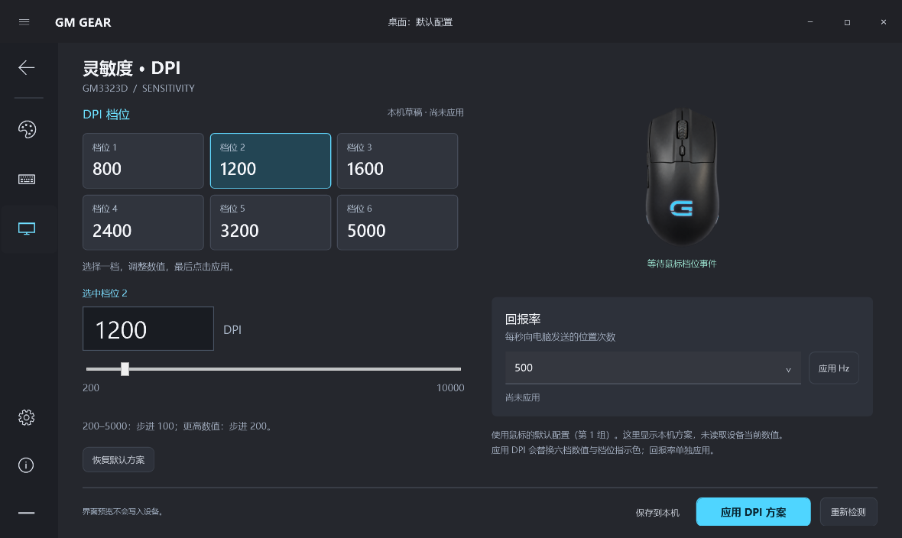

# GM GEAR · GM3323D 控制中心

面向 **GM3323D** 的独立 Windows 鼠标控制软件。按经典 G HUB 的交互布局制作：居中设备主页、顶部桌面配置栏、左侧功能图标栏、灯光面板与设备颜色预览。使用独立名称与参考实物制作的鼠标图，不与罗技或戴尔关联。

基于 [Evan816Z/GM3323D-MouseLight](https://github.com/Evan816Z/GM3323D-MouseLight) 二次开发，复用并移植其原生 HID 枚举与电量监听方案，保留 MIT 许可证和上游 C++ 源码。灯光通讯已更正为实机确认有效的 13 字节独立指令。原来的电量查看器不需要卸载，也不会被新软件替换。

## 当前功能

v0.2.0 加入灵敏度页面：六档 DPI、200–10000 范围、默认选中 1200，以及 125/250/500/1000 Hz 回报率。修复了只发送 DPI 数据却未激活设备配置、导致鼠标没有变化的问题。400 DPI 低速变化已由用户确认，随后恢复 1200。

v0.1.2 根据用户三张实拍修正设备外观：横向掌心标志、人字纹滚轮、左侧双侧键、尾部下沿侧灯带；移除错误的顶面 U 形灯框。主页与灯光页使用同一素材，保留 RGB 预览。

- **设备主页**：GM3323D 连接状态与实测电量，点击鼠标进入配置。
- **灯光面板**：8 种已知灯效、开关、HSV 取色、HEX 输入、颜色预设、1–8 档亮度；白色灯带和掌心标志随所选颜色与亮度预览，保留鼠标外壳材质。
- **灵敏度**：六档 DPI 方案，200–5000 步进 100，5200–10000 步进 200。选择档位后调整数值，点击“应用 DPI 方案”。默认六档为 800/1200/1600/2400/3200/5000，选中第二档。
- **回报率**：125/250/500/1000 Hz 单独应用。DPI 与回报率使用设备第 1 组默认配置；应用 DPI 会替换六档值和对应指示色。页面显示本机方案，未假称读取到了设备的当前 DPI。
- **明确应用**：只有点击“应用到鼠标”才发送设置。保存到本机只保存草稿；启动、重连和载入草稿均不会自动写设备。
- **电量托盘**：后台连续监听，只读 Input Report；断开或长时间无回复清除旧值。
- **独立设置**：可选开机自启，默认关闭；关闭窗口可收起托盘。注册表使用 `HKCU\Software\GM3323DGearHub`，与原工具独立。
- **未适配功能**：按键分配和宏当前只显示状态说明，不提供假控件或写入。

## 运行

下载 GM GEAR 单文件程序 `GM-GearHub.exe`，放到固定位置后双击即可。需要 Windows 10/11 x64 与系统 .NET Framework 4.8；不需要 Python、Node.js、管理员权限或安装内核驱动。

1. 插入 GM3323D 无线接收器，移动鼠标唤醒。
2. 双击 `GM-GearHub.exe`。
3. 在主页点击鼠标，打开灯光配置。
4. 先预览颜色和亮度，准备好后点击“应用到鼠标”。

v0.1.1 修复了灯光无法应用的问题。青色常亮已在实际 GM3323D 上确认生效；界面“已发送”表示系统接受指令，设备实际效果以鼠标为准。

主页点击“灵敏度 · DPI”进入 DPI 页面；也可用 `GM-GearHub.exe --dpi` 直接打开。保存到本机只存草稿，启动与重连不自动应用。

右下角托盘双击可显示主窗口，右键可退出。首次出现的图标可能被 Windows 放进折叠区。按键和宏仍需原厂软件。

## 相比上游的调整

- 前端使用 WPF，硬件层由上游 C++ HID 代码移植为 C# P/Invoke；原 `src/main.cpp` 保持可读。
- 写入需匹配产品名 GM3323D、VID/PID `1D57:FA60`、UsagePage `000B` 和精确 132 字节 Feature 长度，防止仅凭共享编号匹配其它品牌鼠标。
- 灯光发送独立的 13 字节 `0x05` 报告，不再轮询 `GetFeature(0x04)`，也不回写 132 字节模板。132 是集合支持的最大 Feature 长度，不是灯光指令长度。
- 灯光命令仅包含灯效参数，不发送 DPI、按键或宏。效果速度暂使用固定默认值；启动和重连不自动应用。
- DPI / 回报率应用先发送 4 字节默认配置激活指令，等待 550 ms，再分别发送 50 / 9 字节指令。未确认成功时仅报告系统发送状态；不将草稿值作为实测回读。
- 发送放在后台，带取消期限与系统错误提示。
- 电量验证完整事件类型、在线状态和档位范围。`03 00 40 01 08` 表示 80%，不把 `0x40` 当电压，也不把在线字节推断为充电状态。
- 鼠标仍以 10% 档位上报，界面不估算 81%、82% 等中间值。

## 构建与验证

```powershell
powershell -NoProfile -ExecutionPolicy Bypass -File build-hub.ps1 -Tests
.\build\gear-hub\GearHub.Tests.exe
.\build\gear-hub\GearHub.Tests.exe --probe
.\build\gear-hub\GearHub.Tests.exe --ui .\hub\tests\output
```

使用系统 .NET Framework C# 编译器和 WPF，无 NuGet 依赖；输出 `build/gear-hub/GM-GearHub.exe`。UI 测试使用明确标注的示例数据，不访问设备或修改开机设置。`--probe` 只读枚举接口并监听真实电量，不发送灯光设置。

v0.2.0：45 项协议与 UI 检查通过，实机 DPI / 回报率按钮发送通过；400 DPI 低速变化得到用户确认，已恢复 1200。此前青色灯光也已实机确认。详细验证状态见 [VALIDATION.md](docs/VALIDATION.md)。

## 界面预览

以下截图为实际运行界面，电量使用明确标注的示例数据。




鼠标素材生成与校正说明见 [ARTWORK.md](docs/ARTWORK.md)。

当前灯光协议见 [LIGHTING_PROTOCOL.md](docs/LIGHTING_PROTOCOL.md)。上游原说明见 [UPSTREAM_README.md](docs/UPSTREAM_README.md)，历史协议记录见 [protocol.md](docs/protocol.md)；其中 132 字节配置轮询与回写结论已被本机验证纠正。

DPI 与回报率协议见 [SENSITIVITY_PROTOCOL.md](docs/SENSITIVITY_PROTOCOL.md)。

## 许可证

[MIT](LICENSE)。上游版权所有 © 2026 tongz。新增 UI、原生桥接层及测试同样按 MIT 提供。
